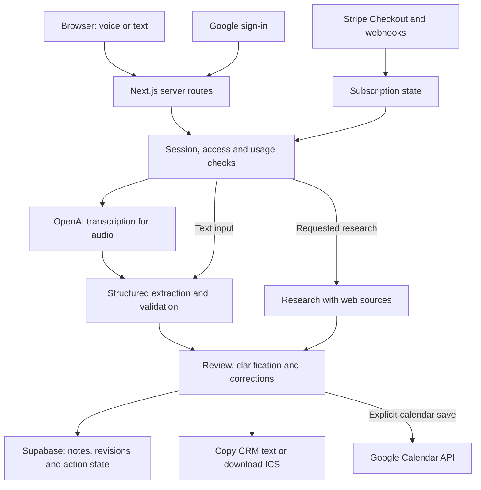

# Folup

**Turn a post-visit voice note into a clear sales record and a follow-up you can act on.**

Folup is a mobile-first web app for field salespeople. After a customer visit, the rep records what happened or pastes a note. Folup turns that input into a structured visit summary, useful customer context, CRM-ready text, and actions that can be reviewed and added to a calendar.

The product is called **Folup**; `fieldbrief` is the repository's historical name.

> **Project status:** Active development has been discontinued. This repository is preserved as a portfolio and technical reference, and as a starting point for a future restart. The original domain and hosted integrations are not guaranteed to be available. Features below describe the implementation in this repository, not a claim that a live service is currently operating.

## The problem it solves

Details from customer visits often remain in a salesperson's memory, scattered voice recordings, or unfinished CRM entries. Folup brings capture, review, and follow-up into one short workflow:

1. **Capture:** Record a voice note in the browser or paste written notes.
2. **Understand:** Transcribe the recording and extract the visit's people, companies, context, commitments, and timing.
3. **Review:** Check the result, resolve missing details, and correct the note using text or voice.
4. **Use:** Copy a CRM-ready record, save the visit, and explicitly add a reviewed action to a calendar.
5. **Return:** Search saved visits and reopen their context and follow-ups.

## What Folup does

### Voice and text capture

- Browser microphone recording and text input.
- English and Spanish note processing, including handling for mixed-language dictation and corrections.
- An English application interface with note output adapted to the detected note language.
- Separate transcription and structured extraction stages.
- Recovery controls for failed recordings: retry the upload, download the audio, or discard it. Audio recovery is held in the current tab; it is not a durable offline backup.

### Structured visit records

Folup extracts contacts, companies, location, a concise summary, relevant insights, and follow-up actions. Actions can include calls, document sends, meetings, and other tasks, with recipients, purpose, dates, and timing where the input supports them.

The extraction and validation logic is designed to preserve negation, uncertainty, quantities, ownership, and the speaker's final corrected meaning. Clarification questions help resolve missing or ambiguous details. These are safeguards around model output, not a guarantee that every extraction is correct.

### Commitments and suggested next steps

Explicit commitments and AI recommendations are represented separately. Folup can propose one **Smart Next Step** with a rationale and timing explanation, while retaining the commitments actually stated in the note.

A proposed action is not evidence that the customer agreed to it. The implementation includes checks intended to avoid unsupported promises, incorrect recipients, duplicated actions, and follow-ups that contradict a no-contact instruction.

An additional candidate-comparison selector exists behind `FOLUP_SMART_SELECTOR=decisions`. It is experimental and is disabled when that setting is absent.

### Corrections and saved history

- Review and correct visit details, including voice corrections to saved notes.
- Save, reopen, search, and delete visit records.
- Copy formatted CRM text for use in an existing CRM.
- Preserve semantic revisions in the database.
- Detect stale edits through version checks and reject conflicting writes instead of silently overwriting a newer note.
- Recognize repeated save requests so a retry does not become a second write.

Revision storage is an internal persistence feature, not a full customer-facing revision browser. Pending save recovery is held in tab memory.

### Calendar follow-ups

- Prepare action titles, descriptions, dates, and times for review.
- Resolve relative dates against the note's reference date and timezone.
- Handle approximate timing and dated prerequisites without treating a suggested time as an agreed appointment.
- Export an `.ics` calendar file.
- Optionally connect Google Calendar and create a 30-minute event in the user's primary calendar after an explicit save action.
- Keep stable action identities and event reservations to reduce duplicate calendar events when a request is retried.

Signing in does not create calendar events. The Google Calendar integration does not invite attendees, automatically update or delete existing events, or track their completion. Deleting a Folup note does not delete its Google Calendar event.

### Research when requested

An explicit request to the assistant, such as asking it to research a technical topic mentioned in a visit, can trigger a separate web-research workflow with source links.

Research is kept separate from customer facts and salesperson commitments. The workflow includes guards to restrict searches to public topics and avoid passing private customer identities into search queries. Ambiguous requests can require clarification, and research failure does not discard an otherwise successful visit extraction.

### Sign-in, trial, and subscriptions

- Google sign-in through Auth.js / NextAuth.
- A signed-in free trial that begins with the first successfully processed note: **14 days, with a maximum of 100 trial notes**.
- Continued access to saved notes and exports after the trial ends; new processing requires eligible access.
- Stripe subscription Checkout, webhook handling, and subscription access checks.
- Server-side usage reservations and rate limits around AI operations.

The repository contains the billing implementation; actual pricing and payment availability depend on the configured Stripe account and price.

### Public preview and installable app

- A public landing page and example walkthrough.
- An optional `/try` flow that processes a real guest note when `GUEST_TRY_ENABLED=true`.
- Guest processing limits, temporary results, and a sign-in flow to claim an existing preview.
- A web app manifest and icons for installation on supported devices.

Folup is **online-first**. It has no service worker, offline processing, push notifications, or background submission queue. The guest flow is disabled by default and needs the database, abuse controls, and expiry cleanup described in the [guest rollout notes](docs/guest-try-rollout.md).

## Example workflow

The following is illustrative, not a recorded customer interaction or an exact model-output guarantee.

> “I met Ana at North Valley. She needs the technical sheet for Product Z, without prices. I promised to send it tomorrow morning. She hasn't approved an order.”

A reviewed record should preserve the request for a technical sheet, the no-prices restriction, and the fact that no order has been approved. The explicit follow-up is to send the sheet. “Tomorrow morning” can be resolved relative to the capture date, but a precise calendar time still needs review.

The rep can then copy the CRM text and choose whether to create a calendar event. Folup does not send the sheet or contact Ana.

## Architecture



**Stack:** Next.js 16 App Router, React 19, TypeScript, Tailwind CSS 4, Auth.js / NextAuth, Supabase PostgreSQL, the OpenAI SDK, Stripe, Google Calendar, Luxon, and optional PostHog instrumentation. Exact dependency versions are recorded in `package.json` and `package-lock.json`.

AI parsing is combined with application rules for dates, action identity, corrections, persistence, and access. A structured model response is not trusted as a finished database write or an instruction to contact a customer.

## Repository guide

- [`app/`](app/) — application pages, public preview, UI components, and server routes.
- [`auth.ts`](auth.ts) — Google authentication and optional Calendar connection handling.
- [`lib/`](lib/) — extraction, transcription, recommendations, research, CRM formatting, scheduling, persistence, access, and analytics logic.
- [`supabase/migrations/`](supabase/migrations/) — historical database migrations, permissions, and transactional functions.
- [`test/`](test/) — automated checks, including database behavior exercised with PGlite.
- [`eval/`](eval/) — synthetic evaluation corpora, recorded outputs, quality checks, and separately invoked API evaluation runners.
- [`scripts/`](scripts/) — development harnesses, UI fixtures, and asset utilities.
- [`docs/`](docs/) — implementation notes, operational requirements, and historical rollout evidence.

## Running or restoring the project

### 1. Install the application

Use a Node.js version compatible with the pinned Next.js release and npm.

```bash
git clone https://github.com/ignaciosoria/fieldbrief.git
cd fieldbrief
npm ci
```

### 2. Restore the database foundation

**This repository is not a complete one-command database bootstrap.** Some migrations alter tables that already existed, including the original notes and subscription schema. Applying every file to an empty database is therefore not sufficient by itself.

To restore a working environment, obtain a compatible schema backup or reconstruct and validate the missing base schema before applying the historical migrations in order. The test fixtures can help explain specific contracts, but they are not a production backup. Do this in a separate development database before reconnecting production services.

### 3. Configure services

Create a local `.env.local` with your own values. This is a configuration guide; credentials and a database backup are not supplied by the repository.

```dotenv
# Application and authentication
NEXTAUTH_URL=http://localhost:3000
NEXT_PUBLIC_SITE_URL=http://localhost:3000
AUTH_SECRET=replace-with-a-long-random-secret
GOOGLE_CLIENT_ID=replace-with-your-google-client-id
GOOGLE_CLIENT_SECRET=replace-with-your-google-client-secret

# Supabase
NEXT_PUBLIC_SUPABASE_URL=https://your-project.supabase.co
NEXT_PUBLIC_SUPABASE_ANON_KEY=replace-with-your-anon-key
SUPABASE_SERVICE_ROLE_KEY=replace-with-your-server-only-key

# AI processing
OPENAI_API_KEY=replace-with-your-openai-key

# Stripe billing
STRIPE_SECRET_KEY=replace-with-your-stripe-secret
STRIPE_PRICE_ID=replace-with-your-subscription-price-id
STRIPE_WEBHOOK_SECRET=replace-with-your-webhook-signing-secret

# Optional guest processing; leave disabled until configured
GUEST_TRY_ENABLED=false
```

- Configure Google's local OAuth callback as `http://localhost:3000/api/auth/callback/google`. Use the matching HTTPS origin and callback for a hosted environment.
- Enable the Google Calendar API and configure the additional Calendar consent flow if testing direct event creation. See [Calendar setup](docs/direct-google-calendar.md).
- Configure Stripe webhook delivery to `/api/stripe/webhook` and use a matching subscription price. Use test-mode resources while developing.
- Keep service-role, OpenAI, Google client-secret, Stripe, and authentication secrets server-side. Do not give them `NEXT_PUBLIC_` prefixes or commit `.env.local`.
- Model settings are defined in [`lib/visitModelConfig.ts`](lib/visitModelConfig.ts), [`lib/transcriptionModel.ts`](lib/transcriptionModel.ts), and [`lib/visitResearchServer.ts`](lib/visitResearchServer.ts). Overrides use `FOLUP_VISIT_MODEL`, `TRANSCRIPTION_MODEL`, and `FOLUP_RESEARCH_MODEL`. Check their supported values and provider availability before restarting; historical defaults are not an availability guarantee.
- Optional browser analytics use `NEXT_PUBLIC_POSTHOG_KEY` and `NEXT_PUBLIC_POSTHOG_HOST`. Analytics code also contains production/domain restrictions; setting a key alone does not enable tracking on any hostname.
- Guest processing has hosting-specific network identification and requires scheduled cleanup of expired previews. Review the [guest deployment requirements](docs/guest-try-rollout.md) before enabling it.

### 4. Start the app

```bash
npm run dev
```

Open `http://localhost:3000`. Recording requires microphone permission and a secure browser context, such as localhost or HTTPS. Authenticated processing, history, billing, and Calendar features require their corresponding services to be configured.

For a production build:

```bash
npm run build
npm start
```

## Validation and evaluation

Available package scripts include:

```bash
npm run lint
npm test
npm run test:output-quality
npm run test:structured-ai
```

The test suite covers extraction contracts, language and corrections, scheduling, calendar retries, note revisions, write conflicts, trials, subscriptions, guest flows, and analytics behavior. The structured-AI script is an additional harness; read it before interpreting its output as an acceptance check.

Read the [evaluation guide](eval/README.md) before running experiments. Synthetic examples and recorded outputs are development evidence, not measured customer accuracy. Some quality checks document desired behavior or known gaps. Historical passing counts do not establish that the current checkout passes; this README does not claim a fresh test run.

Live API evaluation runners are separate from the commands above and can incur provider charges. Follow the evaluation guide's budgeting requirements before invoking them.

## Data handling and boundaries

- Authenticated server routes derive ownership from the session; the client does not choose the account whose notes it can access.
- Notes and extracted records are persisted in Supabase. The processing flow sends audio or text to the configured AI provider; it is not on-device inference.
- Calendar credentials are encrypted server-side and bound to the verified Google identity.
- Analytics code uses allowlisted event properties and privacy controls; it is not intended to collect raw transcripts or full CRM records.
- Entity-foundation and shadow-matching code records and evaluates contact/company mentions. It is groundwork, not an automatically resolved customer directory or a completed CRM memory feature.
- Direct CRM synchronization, automatic customer outreach, email delivery, pipeline management, and autonomous calendar maintenance are outside the implemented product workflow.

## Further technical documentation

- [Direct Google Calendar integration](docs/direct-google-calendar.md)
- [Stable calendar action identities and retry behavior](docs/stable-calendar-actions.md)
- [Note revisions](docs/note-revisions.md)
- [Write conflicts and save retries](docs/note-write-conflicts.md)
- [Entity foundation](docs/entity-foundation.md) and [shadow matching](docs/entity-shadow.md)
- [Guest preview lifecycle](docs/guest-try-rollout.md)
- [Installable PWA behavior](docs/pwa.md)
- [Analytics instrumentation](docs/analytics-instrumentation-20261009.md)
- [Evaluation methodology and fixtures](eval/README.md)

These documents include historical rollout notes. Treat deployment dates and past test results as historical evidence, and verify the environment before resuming development.
